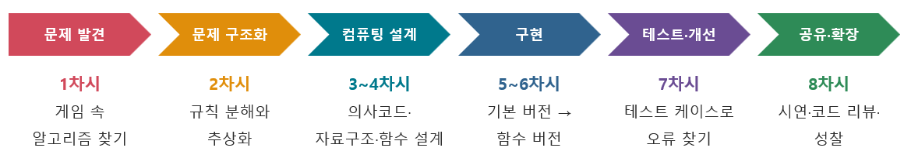

# 이 책에 대하여

이 책은 고등학교 정보 교과 **「알고리즘과 프로그래밍」** 단원을 위한 수업 모형입니다.
단어 맞히기 놀이인 **행맨(Hangman) 게임**을 공통 소재로, 「문제 발견 → 문제 구조화 → 컴퓨팅 설계 → 구현 → 테스트 및 개선 → 공유·확장」의 6단계를 8차시 동안 수행합니다.

## 누구를 위한 책인가요?

- 알고리즘과 프로그래밍 단원 수업을 설계하는 **정보 교사**
- 행맨 게임을 직접 만들어 보며 리스트 · 딕셔너리 · 2차원 리스트 · 함수를 익히려는 **학생**

## 책의 구성

| 장 | 내용 |
|---|---|
| 01 | 교육과정 분석 (성취기준, 핵심 아이디어, 수행평가 과제) |
| 02 | 차시별 6단계 수업 모형 적용 과정 (8차시) |
| 03 | **5~6차시 수업 지도안 (구현 단계 · 본시)** – 그림 6종 포함 |
| 04 | 학생 활동지 1~5와 AI 활용 기록표 |
| 05 | 평가 계획 (성취수준 · 평가 역량 · 피드백) |
| 06 | 학생 산출물 예시 |
| 07 | 교사 수업 설계 및 운영 유의사항 |
| 08 | 예제 코드 5종 (기본 → 함수 → 확장, 빈칸 채우기, 심화) |
| 09 | 자료 내려받기 (지도안 · PPT · 활동지 · 파이썬 파일) |

## 실습 환경

- 파이썬 3 (IDLE 또는 학교 실습 환경). 예제 코드는 파이썬 3.12 이상에서 경고 없이 실행되도록 작성했습니다.
- 변수와 함수 이름은 학생이 읽기 쉽도록 **한글 식별자**를 사용합니다.

> 김해수남고등학교 김동균
