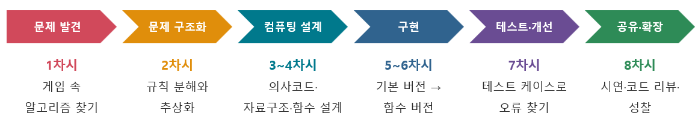

# 02. 차시별 6단계 수업 모형 적용 과정(8차시)

| 단계 | 차시 | 소단원 제목 | 교수-학습 내용 및 과정 |
|---|---|---|---|
| 문제 발견 | 1 | 놀이 속 알고리즘 찾기 – 행맨 게임 체험과 프로젝트 주제 정하기 | • [동기] 교사와 칠판 행맨 한 판 → 교사가 제공한 행맨 게임(game_행맨_2_함수.py)을 직접 실행해 보기 • 행맨 게임의 규칙을 입력(사용자가 하는 일)–처리(컴퓨터가 판단하는 일)–출력(보여 주는 것)–종료 조건으로 정리하기 [활동지 1] • "컴퓨터는 숨겨진 단어와 맞힌 글자를 어떻게 기억하고 있을까?" 질문으로 코드 일부(행맨그림 리스트, 게임화면생성 함수)를 함께 읽어 보기 • 모둠(2~3명) 구성, 프로젝트 게임 선정(행맨 확장 또는 행맨 구조를 적용한 새 게임 기획), 수행평가 기준·AI 활용 규칙 안내 |
| 문제 구조화 | 2 | 행맨 규칙 분해와 추상화 – 문제를 작은 문제로 나누기 | • 행맨 게임을 하위 문제(단어 고르기·화면 그리기·입력 받기와 검사·판정·종료 조건·다시 하기)로 분해하여 분해 트리 그리기 [활동지 2] • 추상화: 게임에 꼭 필요한 요소(비밀 단어, 맞힌 글자, 틀린 글자, 남은 기회, 그림 단계)와 버려도 되는 요소(분필 색, 교수대 모양, 진행자 말투 등) 구분하기 • 각 하위 문제에 필요한 데이터를 변수·리스트·딕셔너리 후보로 적어 보기 (예: 틀린 횟수 = 행맨그림 리스트의 인덱스) • 모둠별 분해 결과를 짧게 공유하고 교사 피드백 받기 |
| 컴퓨팅 설계 | 3~4 | 알고리즘 설계 – 순서도·의사코드와 데이터 구조·함수 설계 | [3차시] 순서도·의사코드로 행맨 한 판의 흐름 설계, 반복(while)과 분기(if–else)의 위치와 두 가지 종료 조건(모두 맞힘 / 6번 틀림) 정하기 [3차시] 데이터 구조 선택: 행맨 그림·단어 목록 → 리스트, 주제별 단어와 뜻·점수 → 딕셔너리, 난이도표·게임 기록표·키보드판 → 2차원 리스트 [4차시] 함수 설계표 작성: 함수 이름·매개변수·반환값·역할 정하기(예: 모두맞췄는지(비밀단어, 맞춘단어) → True / False) https://wikidocs.net/476045 [활동지 3] [4차시] 모둠 간 설계 검토(다른 모둠의 의사코드를 따라가며 빠진 경우 찾기) |
| 구현 | 5~6 | 게임 프로그램 구현 – 기본 버전에서 함수 버전으로 | [5차시] 리스트·반복문·조건문만으로 기본 버전 구현 (예시: game_행맨_1_기본.py, 보충: game_행맨_빈칸채우기.py) [5차시] 문자열 인덱싱·슬라이싱과 in 연산자로 밑줄 단어(_ _ a _) 화면을 만드는 원리 이해하기 [6차시] 하위 문제별로 코드를 함수로 분리하고 main() 구조로 정리(리팩터링) (예시: game_행맨_2_함수.py) [6차시] 딕셔너리·2차원 리스트를 적용하여 주제 선택·뜻 힌트·난이도·기록표 기능 추가 (예시: game_행맨_3_산출물예시.py) [6차시] 주석 달기, 변수 이름 정리, AI 활용 시 활용 기록표 작성 → 세부 지도안은 Ⅲ 수업지도안(본시) 참조 |
| 테스트 및 개선 | 7 | 테스트 케이스로 오류 찾고 개선하기 | • 오류의 종류(문법·실행·논리 오류) 확인, 정상·경계·예외 입력으로 테스트 케이스 표 작성 [활동지 4] • 다른 모둠과 프로그램을 바꾸어 테스트하고 실패 사례 기록 • 입력 검증 함수(strip, lower, len, in 검사, 이미 사용한 글자 검사)로 오류 수정 • 심화: 글자 빈도를 딕셔너리로 세어 ‘먼저 고를 글자’ 전략과 확률 탐구, 기록표(2차원 리스트)를 중첩 반복으로 출력 |
| 공유 확장 | 8 | 게임 시연과 코드 리뷰 – 성능 평가와 확장 | • 갤러리 워크: 모둠별 게임 시연, 다른 모둠이 직접 플레이하고 동료 피드백지 작성 [활동지 5] • 코드 리뷰: 데이터 구조·함수 분리·예외 처리 측면에서 잘된 점과 개선점 공유 • 확장 아이디어 토의: 파일 입출력으로 단어 목록 불러오기·기록 저장, 2인용(친구가 단어 입력) 모드, 난이도별 기회 수 조절, 클래스(객체)로 게임 구조화 • 최종 산출물(.py, 활동지, AI 활용 기록) 제출 및 프로젝트 성찰 쓰기 |

> 3~4차시 참고 자료: https://wikidocs.net/476045
