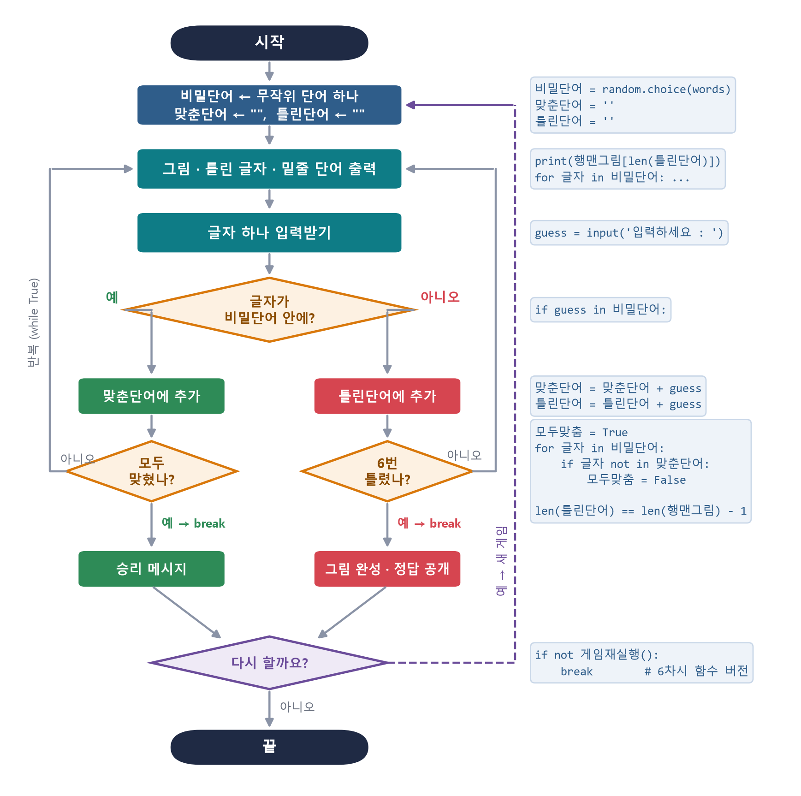
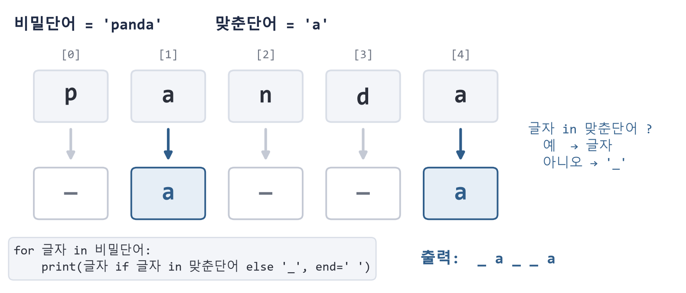

**주제:** 의사코드를 리스트 · 반복문 · 조건문으로 옮기기

| 단계 | 활동 | 핵심 질문 | 교수-학습 활동 |
|---|---|---|---|
| **열기** | 동기 유발 및 안내 | “의사코드 한 줄은 파이썬 코드 몇 줄이 될까?” | **[동기 유발] (3분)** • 지난 차시 [활동지 3]의 의사코드를 화면에 띄우고, 완성된 행맨(game_행맨_2_함수.py)을 1판 시연 • “의사코드의 ‘밑줄 단어를 출력’은 파이썬으로 어떻게 쓸까?” 질문으로 설계와 코드 사이의 거리 느끼기 • 오늘의 산출물: 함수 없이 동작하는 행맨 기본 버전 (game_행맨_1_기본.py 수준) |
|   |   |   | **[학습 목표 및 활동 안내] (2분)** • 의사코드를 리스트·반복문·조건문으로 옮겨 행맨 기본 버전을 구현할 수 있다. • 문자열 인덱싱과 in 연산자를 활용하여 밑줄 단어 화면을 만들 수 있다. • 활동 순서: 개념 확인 → 화면 출력 → 입력·판정 → 종료 조건 → 짝 점검 → 정리 (&lt;그림 1&gt;) |
| **펼치기** | 개념 확인 | “행맨을 만드는 데 필요한 파이썬 도구는 무엇일까?” | **[개념 확인] (5분)** • random.choice(리스트), 문자열 연결(+), in 연산자, len(), while True와 break를 짧은 예제로 확인 • 퀴즈: 'a' in 'panda' → ?  /  len('') → ?  /  행맨그림[len('ab')]는 몇 번째 그림? • 짝 역할 정하기: 드라이버(코드 입력)·내비게이터(의사코드 대조), 10분마다 교대 |
|   | 탐구 활동 | “그림과 밑줄 단어는 어떻게 화면에 나타날까?” | **[탐구 1: 화면 출력 구현] (10분)** • 행맨그림 리스트에서 len(틀린단어)번째 그림 출력 – 틀린 횟수가 곧 인덱스임을 확인 • for 글자 in 비밀단어: 반복과 in 검사로 밑줄 단어(_ a _ _ a) 출력 (&lt;그림 3&gt;) • 확인: 맞춘단어 = 'a'처럼 값을 직접 바꾸어 실행하며 출력 변화 관찰 |
|   |   | “입력한 글자는 어디에 기록해야 할까?” | **[탐구 2: 입력과 판정 구현] (10분)** • input()으로 글자를 받고 if guess in 비밀단어: 로 판정 • 맞으면 맞춘단어, 틀리면 틀린단어에 이어 붙이기(문자열 +) → 다음 반복에서 화면이 바뀌는지 확인 • 교사 순회: “틀린 글자를 기록하지 않으면 그림은 어떻게 될까?” 질문 |
|   |   | “게임은 언제, 어떻게 끝나야 할까?” | **[탐구 3: 종료 조건 구현] (8분)** • 종료 조건 ① 모두 맞힘: 모두맞춤 = True로 두고, for 반복 중 못 맞힌 글자가 있으면 False (깃발 변수) • 종료 조건 ② 6번 틀림: len(틀린단어) == len(행맨그림) - 1 이면 정답 공개 후 break • 순서도(&lt;그림 2&gt;)와 내 코드를 한 칸씩 짚어 가며 빠진 분기 확인 |
|   | 점검 및 보충 심화 | “내 코드는 의사코드의 모든 줄을 구현했을까?” | **[짝 점검] (4분)** • 짝과 코드를 바꾸어 의사코드 줄마다 대응하는 코드에 ✓ 표시, 승리·패배를 각 1번씩 실행하여 확인 • 오류 메시지가 나면 문법·실행 오류 위치를 함께 찾기 (7차시 테스트 활동 예고) |
|   |   | “먼저 끝낸 모둠은 무엇을 더할 수 있을까?” | **[보충·심화] (4분) – 수준별 선택** • 보충: game_행맨_빈칸채우기.py의 빈칸 ①~⑩ 채우기, 의사코드 카드 순서 맞추기 • 심화: 남은 기회 표시하기, 단어 목록을 우리 모둠 주제로 바꾸기, 대문자 입력 처리(lower) 미리 해 보기 |
| **넓히기** | 공유 | “기본 버전의 아쉬운 점은 무엇일까?” | **[공유 및 정리] (4분)** • 1~2개 모둠 시연, ‘가장 막혔던 줄’과 해결 방법 공유 • 같은 코드가 반복되거나 너무 길어진 곳 찾기 → 다음 차시 ‘함수로 정리하기’ 예고 • 코드 저장(파일명 규칙 안내), AI를 활용했다면 AI 활용 기록표 작성 |

## 시각 자료

*<그림 2> 행맨 한 판 순서도와 대응 코드 (5차시 탐구 1~3)*

*<그림 3> 문자열과 in 연산자로 밑줄 단어 만들기 (5차시 탐구 1)*
