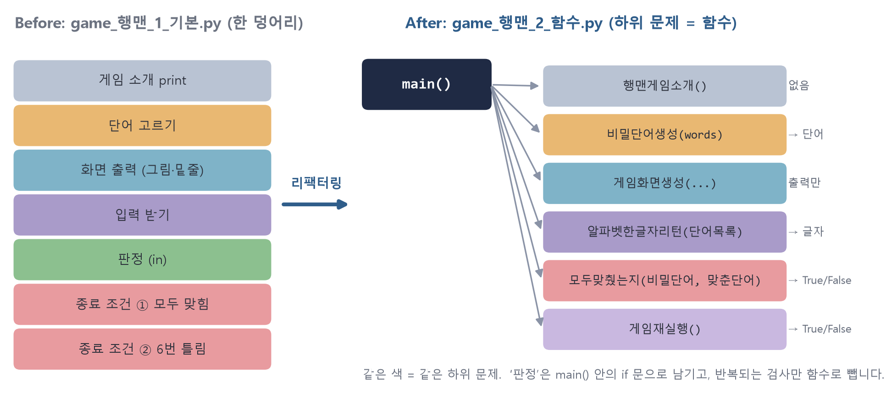
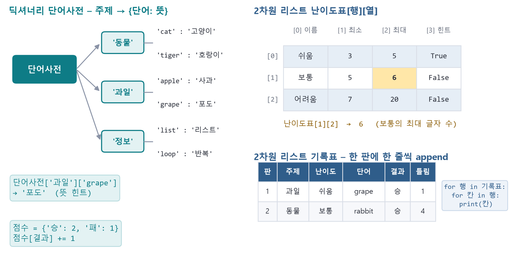
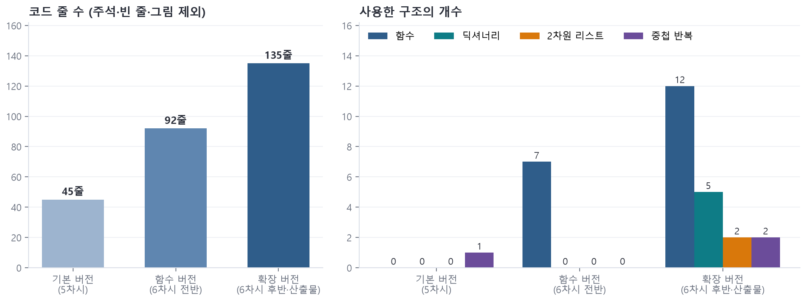

**주제:** 함수로 정리하고 딕셔너리 · 2차원 리스트로 확장하기

| 단계 | 활동 | 핵심 질문 | 교수-학습 활동 |
|---|---|---|---|
| **열기** | 동기 유발 및 안내 | “규칙이 바뀌면 코드의 어디를 고쳐야 할까?” | **[동기 유발] (3분)** • 5차시 기본 버전을 띄우고 “주제를 고르는 기능을 넣으려면 어디를 고쳐야 할까?” 질문 → 한 덩어리 코드에서 찾기 어려움 체감 • 같은 동작을 함수로 나눈 game_행맨_2_함수.py와 나란히 비교 (&lt;그림 4&gt;) |
|   |   |   | **[학습 목표 및 활동 안내] (2분)** • 하위 문제를 매개변수와 반환값이 있는 함수로 분리하여 main() 구조로 정리할 수 있다. • 딕셔너리와 2차원 리스트를 활용하여 주제 선택·뜻 힌트·난이도·기록표 기능을 추가할 수 있다. • 활동 순서: 개념 확인 → 함수 분리 → 딕셔너리 → 2차원 리스트 → 짝 점검 → 정리 |
| **펼치기** | 개념 확인 | “함수는 무엇을 받고 무엇을 돌려줄까?” | **[개념 확인] (5분)** • def, 매개변수, return, 함수 호출, if __name__ == '__main__': main() 구조 확인 • [활동지 3]의 함수 설계표와 실제 함수(모두맞췄는지 → True/False) 연결하기 • 퀴즈: return이 없는 함수의 결과는?  함수 안에서 만든 변수를 밖에서 쓸 수 있을까? |
|   | 탐구 활동 | “하위 문제 하나를 함수 하나로 바꾸어 볼까?” | **[탐구 1: 함수로 분리하기(리팩터링)] (10분)** • 종료 조건 ①을 모두맞췄는지(비밀단어, 맞춘단어)로, 화면 출력을 게임화면생성(...)으로 분리 • 입력 받기를 알파벳한글자리턴(단어목록)으로 분리하고 main()에서 호출 (&lt;그림 4&gt;) • 분리 후 반드시 실행하여 기능이 그대로인지 확인 (리팩터링 = 동작은 같고 구조만 개선) |
|   |   | “주제별 단어와 뜻은 어떤 구조에 담으면 좋을까?” | **[탐구 2: 딕셔너리 적용] (10분)** • 단어사전 = {'동물': {'cat': '고양이', …}, '과일': {…}}로 주제별 단어와 뜻 저장 (&lt;그림 5&gt;) • 주제를 번호로 고르고 단어사전[주제]에서 비밀 단어 선택, 단어사전[주제][비밀단어]로 뜻 힌트 출력 • 점수 = {'승': 0, '패': 0}에 결과 누적 (점수[결과] += 1) |
|   |   | “여러 판의 기록을 표처럼 저장하려면?” | **[탐구 3: 2차원 리스트 적용] (8분)** • 난이도표 = [['쉬움', 3, 5, True], …]에서 난이도표[행][열]로 글자 수 범위 읽기 • 판이 끝날 때마다 기록표.append([판, 주제, 난이도, 단어, 결과, 틀림]) 후 중첩 반복문으로 표 출력 • 교사 순회: 행·열 순서를 바꾸어 쓴 인덱싱 오류를 함께 추적 |
|   | 점검 및 보충 심화 | “함수로 나눈 뒤에도 게임이 똑같이 동작할까?” | **[짝 점검] (4분)** • 리팩터링 전후를 같은 입력으로 실행하여 결과 비교, 함수 이름·매개변수·반환값이 설계표와 일치하는지 확인 • 수행평가 체크: 2차원 리스트·딕셔너리를 1개 이상 목적에 맞게 사용했는가 |
|   |   | “2차원 리스트로 또 무엇을 표현할 수 있을까?” | **[보충·심화] (4분) – 수준별 선택** • 보충: game_행맨_3_산출물예시.py를 실행하고 단어사전에 새 주제 추가하기 • 심화: 키보드판 2차원 리스트를 중첩 반복으로 출력하여 맞힌 글자·틀린 글자 표시, 난이도별 기회 수 조절 |
| **넓히기** | 공유 | “우리 게임은 얼마나 성장했을까?” | **[공유 및 정리] (4분)** • 버전별 함수·자료구조 수 변화(&lt;그림 6&gt;)를 보며 오늘 추가한 구조를 모둠별로 한 문장 발표 • 다음 차시 예고: 7차시 ‘테스트 케이스로 오류 찾고 개선하기’ – 친구가 이상한 값을 넣어도 버틸까? • 코드 저장, AI를 활용했다면 AI 활용 기록표 작성 |

## 시각 자료

*<그림 4> 리팩터링 전후 코드 구조 – 하위 문제 하나 = 함수 하나 (6차시 탐구 1)*

*<그림 5> 딕셔너리 단어사전과 2차원 리스트 난이도표·기록표 (6차시 탐구 2~3)*

*<그림 6> 버전별 코드 구조 변화 – 제공 예시 코드 3종을 실제로 분석한 결과 (6차시 정리)*
