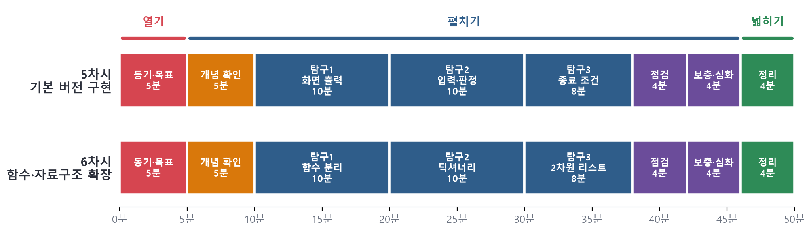

# 03. 5~6차시 수업 지도안 (구현 단계 · 본시)

- 대상·차시: 고등학교 1학년 / 5~6차시(전체 8차시 중), 차시당 50분 / 6단계 수업 모형 중 ④ 구현 단계
- 차시 목표: [5차시] 의사코드를 리스트·반복문·조건문으로 옮겨 행맨 기본 버전을 완성할 수 있다.  [6차시] 하위 문제를 함수로 분리하고, 딕셔너리·2차원 리스트로 기능을 확장할 수 있다.
- 준비물: 학생 노트북(파이썬 3·IDLE), 수업 PPT, game_행맨_1_기본.py · game_행맨_빈칸채우기.py · game_행맨_2_함수.py · game_행맨_3_산출물예시.py, [활동지 3](의사코드·함수 설계표), AI 활용 기록표
- 수업 전략: 짝 프로그래밍(드라이버·내비게이터 10분마다 교대), 의사코드 한 줄 ↔ 코드 한 덩어리 대응, 수준별 스캐폴딩(빈칸 채우기 → 기본 → 함수 → 확장)

*<그림 1> 5~6차시 수업 흐름과 시간 배분 (차시당 50분)*

| 차시 | 주제 | 핵심 산출물 |
|---|---|---|
| 5차시 | 행맨 기본 버전 구현 – 의사코드를 리스트·반복문·조건문으로 옮기기 | 함수 없이 동작하는 행맨 (`hangman_1_basic.py` 수준) |
| 6차시 | 함수로 정리하고 딕셔너리 · 2차원 리스트로 확장하기 | 함수 버전 + 주제·난이도·기록표 기능 (`hangman_3_extended.py` 참고) |

세부 지도안은 하위 페이지에서 확인하세요.
