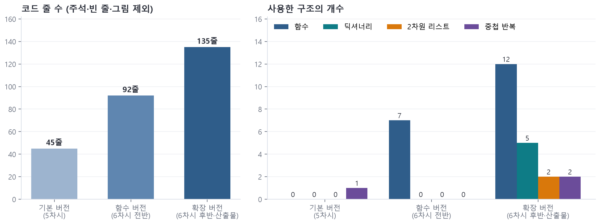

학생에게 배포하는 파이썬 예제 코드입니다. 수업 단계에 따라 기본 → 함수 → 확장 순서로 발전합니다.

| 파일 | 차시 | 핵심 요소 | 내려받기 |
|---|---|---|---|
| 기본 버전 | 5차시 | 리스트, 문자열, while·for, if (7차시 테스트용으로 입력 검사 생략) | [hangman_1_basic.py](https://cdn.jsdelivr.net/gh/nabilera1/highschool_unit3_programming@main/downloads/hangman_1_basic.py) |
| 함수 버전 | 6차시 | 함수, 매개변수·반환값, main(), 입력 검증 | [hangman_2_function.py](https://cdn.jsdelivr.net/gh/nabilera1/highschool_unit3_programming@main/downloads/hangman_2_function.py) |
| 산출물 예시(확장) | 6~8차시 | 딕셔너리, 2차원 리스트, 중첩 반복 | [hangman_3_extended.py](https://cdn.jsdelivr.net/gh/nabilera1/highschool_unit3_programming@main/downloads/hangman_3_extended.py) |
| 빈칸 채우기 | 5~6차시 보충 | 빈칸 ①~⑩ | [hangman_fill_in_blanks.py](https://cdn.jsdelivr.net/gh/nabilera1/highschool_unit3_programming@main/downloads/hangman_fill_in_blanks.py) |
| 심화: 글자 빈도 | 7차시 심화 | 딕셔너리로 빈도 세기, 확률 | [hangman_letter_frequency.py](https://cdn.jsdelivr.net/gh/nabilera1/highschool_unit3_programming@main/downloads/hangman_letter_frequency.py) |

